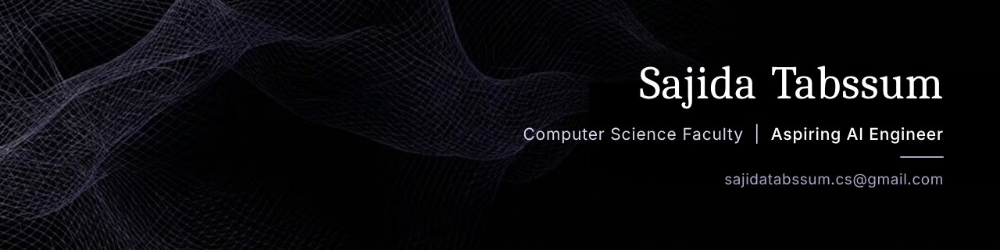

<!-- HEADER BANNER -->

  

<!-- SOCIAL LINKS -->

  
  
  
  
  

---

##  About Me

I'm a Computer Science Faculty member at GU Tech with a professional background in Data Analytics, SAP Analytics Cloud, SQL, reporting automation, and software development.

I'm currently pursuing postgraduate studies in Data Science & AI and building practical experience in Machine Learning through hands-on projects, experimentation, and model development.

Alongside university teaching, I run **Future Coders Lab**, an independent programming education initiative offering practical coding training for beginners, undergraduate students, and individuals transitioning into technical careers.

## 🛠️ Technical Skills

**Programming & Data Analysis**

**Data Science & Machine Learning**

**Web Development**

## Teaching

Computer Science Faculty at GU Tech.

Courses taught:

- Programming Fundamentals & Problem Solving (C and Python)
- Object-Oriented Programming (C++)
- Data Structures

##  Featured Work

- **Data Analytics:** Dashboards, SQL, reporting automation and data visualization.
- **Machine Learning:** Regression, classification, data preprocessing and model evaluation.
- **Software Development:** Web applications and programming projects.
- **Future Coders Lab:** Independent programming education and training.

---

  <i>Building, learning, teaching, and engineering with purpose.</i>

